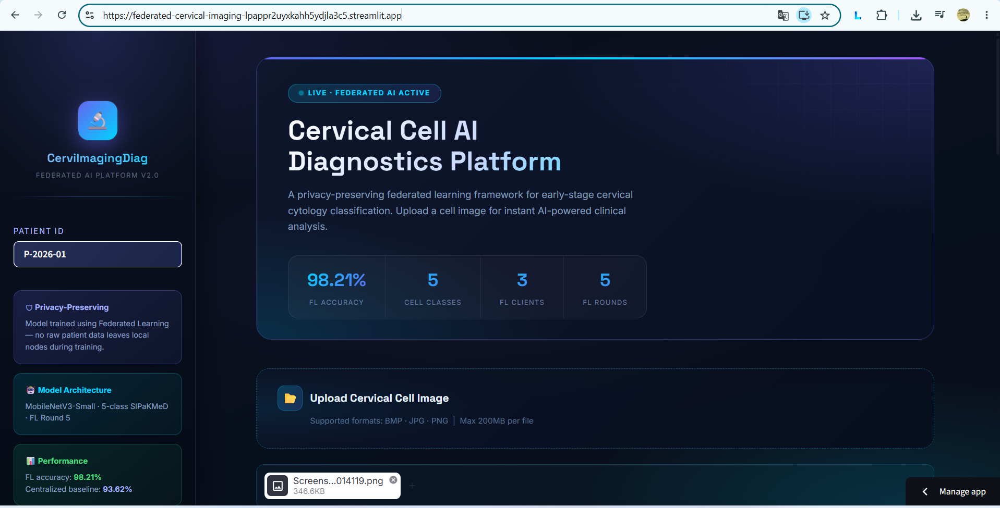
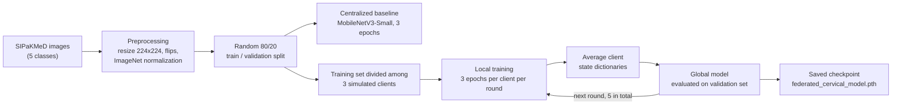
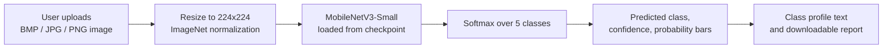

<div align="center">

# 🔬 Federated Cervical Cell Image Classification

### A privacy-preserving federated learning framework for cervical cytology, with an interactive diagnostic web app

<p>
  
  
  
  
</p>

<p>
  <a href="https://federated-cervical-imaging-lpappr2uyxkahh5ydjla3c5.streamlit.app/"></a>
  <a href="notebooks/federated-learning-of-medical-imaging.ipynb"></a>
</p>

<table>
  <tr>
    <td align="center"><b>98.21%</b><br/><sub>Federated validation accuracy<br/>(Round 5)</sub></td>
    <td align="center"><b>93.62%</b><br/><sub>Centralized baseline<br/>validation accuracy</sub></td>
    <td align="center"><b>3</b><br/><sub>Simulated clients</sub></td>
    <td align="center"><b>5</b><br/><sub>Federated rounds</sub></td>
    <td align="center"><b>5</b><br/><sub>Cell classes</sub></td>
  </tr>
</table>

<br/>


**Live demo:** <https://federated-cervical-imaging-lpappr2uyxkahh5ydjla3c5.streamlit.app/>
<sub><i>The deployed Streamlit application (landing view).</i></sub>

</div>

---

## 📑 Table of Contents

1. [Abstract](#-abstract)
2. [Motivation](#-motivation)
3. [Key Results](#-key-results)
4. [System Overview](#-system-overview)
5. [Dataset](#-dataset)
6. [Methodology](#-methodology)
7. [Web Application](#-web-application)
8. [Extended Team Experiments](#-extended-team-experiments)
9. [Repository Structure](#-repository-structure)
10. [Getting Started](#-getting-started)
11. [Technology Stack](#-technology-stack)
12. [Limitations and Responsible Use](#-limitations-and-responsible-use)
13. [Future Work](#-future-work)
14. [Team and Acknowledgements](#-team-and-acknowledgements)
15. [References](#-references)
16. [Disclaimer](#-disclaimer)

---

## 📝 Abstract

This project studies **federated learning (FL)** for **cervical cytology image classification**. A MobileNetV3-Small network, initialized with ImageNet weights, is trained on the **SIPaKMeD** dataset to classify cervical cell images into five categories.

Two training regimes are compared inside a single PyTorch notebook:

- a **centralized baseline**, trained on the pooled training data, and
- a **simulated federated setup**, in which the training data is divided among three clients. Each client trains locally, and the resulting model parameters are averaged into a global model over five communication rounds.

The best recorded federated model reaches **98.21 %** validation accuracy at Round 5, against **93.62 %** for the centralized baseline. The trained checkpoint is served through a **Streamlit web application** that accepts a cell image, returns the predicted class with a confidence score and a class-probability breakdown, and produces a downloadable text report.

> **Scope note.** Federated training happens **offline in the notebook** as a simulation on one machine. The web application performs **inference only**, using the saved global model.

---

## 🎯 Motivation

Medical images are sensitive, and institutions are often unable to pool them into one central dataset. Federated learning addresses this by sending **model parameters** to a coordinator instead of sending **raw images**. This project demonstrates the idea on a cervical cell classification task:

- client data partitions stay local during every training round;
- only model parameters are combined to form the global model;
- the resulting model is made available through a simple, interactive interface.

The work is intended for **researchers and students** exploring cervical cell image classification and federated optimization.

---

## 🏆 Key Results

All figures below are the **validation accuracies recorded in the training notebook's saved outputs**.

| Setting | Validation Accuracy | Δ vs. Centralized |
| :-- | :--: | :--: |
| Centralized baseline (3 epochs) | **93.62 %** | — |
| Federated · Round 1 | 96.81 % | +3.19 pp |
| Federated · Round 2 | 96.71 % | +3.09 pp |
| Federated · Round 3 | 97.71 % | +4.09 pp |
| Federated · Round 4 | 96.91 % | +3.29 pp |
| Federated · **Round 5 (deployed model)** | **98.21 %** | **+4.59 pp** |

A separate final evaluation cell in the notebook records **98.01 %**. The figure of 98.21 % shown in the app is the Round 5 validation accuracy from the table above.

> Read these numbers together with the [Limitations](#-limitations-and-responsible-use) section. They come from a single run on a random 80/20 split, and the baseline and federated settings do not use the same training budget.

---

## 🧭 System Overview

### Training pipeline (notebook)



### Inference pipeline (web app)



---

## 🧫 Dataset

The project uses **SIPaKMeD**, a collection of cervical cell images organized into five classes. The dataset is accessed through the [Kaggle SIPaKMeD page](https://www.kaggle.com/datasets/prahladmehandiratta/cervical-cancer-largest-dataset-sipakmed). The original dataset is described in Plissiti et al., ICIP 2018 (see [References](#-references)).

The table below shows how each class is presented **inside the web app**. The category, risk label and advice text are **fixed text written into `app/app.py` for each class**. They are not produced by the model.

| Class label | Category shown in the app | Risk label in the app |
| :-- | :-- | :--: |
| `im_Dyskeratotic` | Abnormal / High-Grade Squamous Intraepithelial Precursor | 🔴 High |
| `im_Koilocytotic` | Abnormal / Low-Grade Precancerous Change (HPV-related) | 🟠 Moderate |
| `im_Metaplastic` | Benign / Metaplastic Transformation | 🟢 Normal |
| `im_Parabasal` | Benign / Immature Squamous Cells | 🟢 Normal |
| `im_Superficial-Intermediate` | Normal / Healthy Mature Cells | 🟢 Normal |

---

## ⚙️ Methodology

### 1. Preprocessing

- Images are resized to **224 × 224** pixels.
- Training images receive **random horizontal and vertical flips**.
- Images are normalized with **ImageNet statistics** (mean `[0.485, 0.456, 0.406]`, std `[0.229, 0.224, 0.225]`).
- At inference time, the app applies the same resize and normalization, without flips.

### 2. Model

- **MobileNetV3-Small** with ImageNet-initialized weights.
- The final classifier layer is replaced with a linear layer that outputs **5 classes**.
- MobileNetV3-Small is a compact architecture, which makes it a sensible choice for edge-style and mobile-health settings.

### 3. Centralized baseline

The model is trained on the pooled training split for **three epochs** and evaluated on the validation split. This gives the **93.62 %** reference point.

### 4. Federated simulation

1. The training data is divided among **three simulated clients**.
2. In each of **five rounds**, every client trains a local copy of the global model for **three epochs** on its own partition.
3. The clients' model **state dictionaries are averaged** to form the updated global model (federated averaging in the sense of McMahan et al.).
4. The global model is evaluated on the **validation set** after each round.
5. The Round 5 model is saved as the deployed checkpoint.

The notebook saves model checkpoints and round-wise accuracy results to its Kaggle working directory.

---

## 🖥️ Web Application

**Live demo:** <https://federated-cervical-imaging-lpappr2uyxkahh5ydjla3c5.streamlit.app/>

The Streamlit interface in [`app/app.py`](app/app.py) loads [`app/federated_cervical_model.pth`](app/federated_cervical_model.pth) and offers the following.

| Feature | Description |
| :-- | :-- |
| 📂 **Image upload** | Accepts **BMP, JPG and PNG** cell images (Streamlit's default 200 MB per-file limit applies). |
| 🆔 **Patient ID field** | Free-text label in the sidebar. It appears in the on-screen report and in the downloaded file name. |
| 🧬 **Prediction** | Shows the predicted class and the softmax confidence score. |
| 📈 **Probability distribution** | Shows a bar for each of the five classes. |
| 📋 **Class profile** | Displays the fixed category, cellular description and suggested next steps for the predicted class. |
| ⬇️ **Report download** | Exports a plain-text report named `CerviDiag_<patient_id>.txt`. |
| ⚠️ **Disclaimer** | A research-use notice is shown in the sidebar and under each result. |

**Implementation notes**

- The model is loaded once and cached with `st.cache_resource`.
- The checkpoint path is resolved **relative to `app.py`**, so the app can be started from the repository root or from inside `app/`.
- The code does not write uploaded images or patient IDs to disk.
- The headline numbers in the interface (98.21 % FL accuracy, 93.62 % baseline, 3 clients, 5 rounds) are **static text taken from the notebook results**. They are not computed live.

---

## 🧪 Extended Team Experiments

Beyond the deployed MobileNetV3-Small model described above, the team's project plan covers further federated-learning experiments. The workstreams and their owners are listed below.

| Workstream | Owner |
| :-- | :-- |
| Federated pipeline architecture, MobileNet baseline and drift experiment | Astha Jaiswal |
| Model aggregation comparison (FedAvg / FedProx) | Astha Jaiswal, Abhishek Kumar |
| EfficientNet baseline and drift experiment | Abhishek Kumar |
| Dataset preprocessing and **Non-IID (Dirichlet) data distribution** | Abhavya Mishra |
| YOLOv8 integration and evaluation | Abhavya Mishra |

> **Reading note.** All accuracy figures in this README refer only to the deployed MobileNetV3-Small model. Results for the workstreams above are not reproduced here; please refer to the project report and to the experiment notebooks in the repository.

---

## 🗂️ Repository Structure

```text
Federated-Cervical-Imaging/
├── app/
│   ├── app.py                                   # Streamlit application
│   └── federated_cervical_model.pth             # Trained global model (state dict)
├── notebooks/
│   └── federated-learning-of-medical-imaging.ipynb   # Baseline + federated training
├── assets/
│   └── app-home.png                             # README screenshot
├── requirements.txt                             # Application dependencies
├── .gitignore
└── README.md
```

---

## 🚀 Getting Started

### Option A: Use the live app

Open the [live demo](https://federated-cervical-imaging-lpappr2uyxkahh5ydjla3c5.streamlit.app/), upload a cervical cell image, and click **Run Federated AI Diagnostics**.

### Option B: Run locally

**Prerequisites:** Python 3 and `pip`.

**Windows (PowerShell)**

```powershell
git clone https://github.com/AmitK241/Federated-Cervical-Imaging.git
cd Federated-Cervical-Imaging

py -m venv .venv
.venv\Scripts\Activate.ps1

python -m pip install --upgrade pip
python -m pip install -r requirements.txt

python -m streamlit run app/app.py
```

**macOS / Linux**

```bash
git clone https://github.com/AmitK241/Federated-Cervical-Imaging.git
cd Federated-Cervical-Imaging

python3 -m venv .venv
source .venv/bin/activate

python -m pip install --upgrade pip
python -m pip install -r requirements.txt

python -m streamlit run app/app.py
```

Open the local address printed by Streamlit, then upload a cell image.

> `requirements.txt` installs the **CPU build of PyTorch** (through the PyTorch CPU wheel index), which keeps the install light and suitable for hosted deployment. The app uses a GPU automatically if one is available.

### Option C: Re-run the training notebook

The notebook, [`notebooks/federated-learning-of-medical-imaging.ipynb`](notebooks/federated-learning-of-medical-imaging.ipynb), is designed for **Kaggle's dataset environment** (where a GPU can be enabled). It uses `kagglehub`, `numpy`, `pandas` and `matplotlib` in addition to the application's PyTorch dependencies.

To run it outside Kaggle, install those packages and set `dataset_path` to the downloaded SIPaKMeD directory, which must contain the five class folders.

### Deploy your own copy (Streamlit Community Cloud)

1. Fork this repository.
2. On [share.streamlit.io](https://share.streamlit.io), choose **Create app** and pick your fork.
3. Set the branch to `main` and the **main file path** to `app/app.py`.
4. Click **Deploy**.

---

## 🧰 Technology Stack

| Layer | Tools |
| :-- | :-- |
| Deep learning | PyTorch, TorchVision (MobileNetV3-Small) |
| Image handling | Pillow |
| Web application | Streamlit (the UI uses custom HTML/CSS through `st.html`, so a recent Streamlit release is needed) |
| Notebook environment | Kaggle, `kagglehub`, NumPy, pandas, Matplotlib |
| Hosting | Streamlit Community Cloud |

---

## 🔍 Limitations and Responsible Use

Stating these openly is part of reporting the results correctly.

- **Simulated federation.** The three "clients" are partitions of one dataset, trained on a single machine. There is no real network, no communication cost and no privacy mechanism beyond keeping the partitions separate in code. This is not a deployed multi-hospital system.
- **Validation-based reporting.** Accuracies are measured on a random 80/20 validation split, and the reported Round 5 model is the last of five rounds. The notebook does not describe a separate held-out test set.
- **Not a compute-matched comparison.** The centralized baseline trains for 3 epochs. In the federated run, each client trains for 3 epochs in each of 5 rounds. The gap between 93.62 % and 98.21 % should therefore not be read as a controlled measurement of "federated vs. centralized" alone.
- **Single run.** The recorded results come from one run, with no repeated seeds or confidence intervals.
- **Accuracy only.** Per-class precision, recall and a confusion matrix are not part of the recorded results.
- **Static clinical text.** The category, risk label and recommended next steps shown in the app are fixed per class. They are not generated by the model and are not individualized to a patient.
- **Inference is not federated.** The "federated" aspect refers to how the model was trained. At prediction time, the app runs one saved model on the server.
- **Dataset domain.** The model is trained on SIPaKMeD images and has not been validated on images from other laboratories, stains or scanners.

---

## 🔭 Future Work

These are directions for extending the study. They are **not** part of the deployed version.

- **Unified reporting:** present the Non-IID (Dirichlet), FedAvg vs. FedProx and alternative-backbone results in the same format as the main results table.
- **Varying the number of clients:** study how accuracy and convergence change as the client count grows beyond three.
- **Stronger evaluation:** add a held-out test set, a confusion matrix, per-class metrics and multiple random seeds.
- **Compute-matched baseline:** train the centralized model for an equivalent total number of epochs.
- **Interpretability:** add visual explanations such as Grad-CAM for individual predictions.

---

## 👥 Team and Acknowledgements

This project was developed as a **final-year group project** at the **Department of Computer Science and Engineering, Motilal Nehru National Institute of Technology Allahabad (MNNIT), Prayagraj**, in the academic year **2026–27**.

**Mentor:** Prasun Chandra Tripathi

| Member | GitHub | Responsibilities |
| :-- | :-- | :-- |
| **Astha Jaiswal** | [@asthajaiswal312](https://github.com/asthajaiswal312) | FL pipeline architecture, MobileNet baseline and drift experiment, model aggregation (FedAvg / FedProx) |
| **Abhavya Mishra** | [@abhavyamishra](https://github.com/abhavyamishra) | YOLOv8 integration and evaluation, dataset preprocessing, Non-IID Dirichlet distribution implementation |
| **Abhishek Kumar** | [@abhiishhekk](https://github.com/abhiishhekk) | EfficientNet baseline and drift experiment, model aggregation (FedAvg / FedProx) |
| **Amit Kumar** | [@AmitK241](https://github.com/AmitK241) | Initial data exploration, documentation of experimental results, Streamlit application development, report compilation |

We thank our mentor, **Prasun Chandra Tripathi**, for his guidance throughout the project.

---

## 📚 References

1. Plissiti, M. E. et al. "SIPAKMED: A New Dataset for Feature and Image Based Classification of Normal and Pathological Cervical Cells in Pap Smear Images." *2018 IEEE International Conference on Image Processing (ICIP)*, 2018. <https://doi.org/10.1109/ICIP.2018.8451588>
2. McMahan, B. et al. "Communication-Efficient Learning of Deep Networks from Decentralized Data." *Proceedings of the 20th International Conference on Artificial Intelligence and Statistics (AISTATS)*, 2017. <https://proceedings.mlr.press/v54/mcmahan17a.html>
3. Howard, A. et al. "Searching for MobileNetV3." *Proceedings of the IEEE/CVF International Conference on Computer Vision (ICCV)*, 2019. <https://arxiv.org/abs/1905.02244>
4. PyTorch TorchVision. [MobileNetV3 model documentation](https://docs.pytorch.org/vision/stable/models/mobilenetv3.html).

This project is inspired by research architectures such as **CerviImagingDiag**, whose name is also used for the application's branding. It is an independent student implementation and is not the original authors' code.

---

## ⚠️ Disclaimer

This software is provided for **research and educational purposes only**. It is **not** a medical device and is **not** intended to replace professional medical advice, diagnosis or treatment. Always consult a qualified, licensed healthcare provider for any medical concern.

---

<div align="center">

<sub>Built with PyTorch and Streamlit · If you find this project useful, consider giving it a ⭐</sub>

</div>
